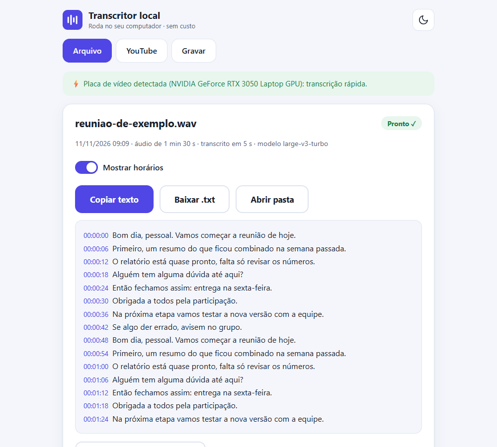
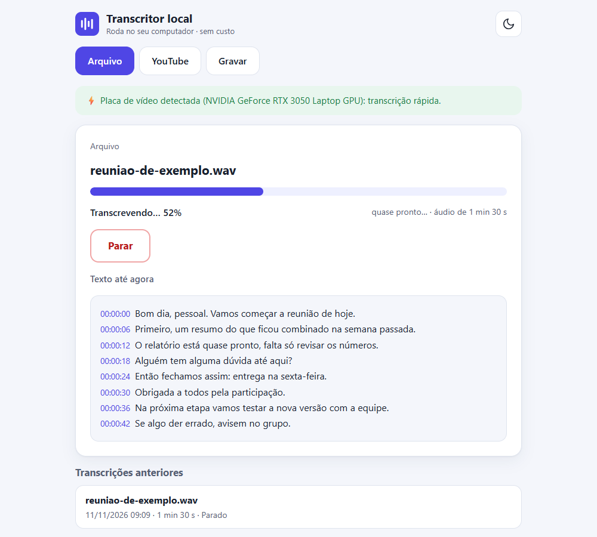
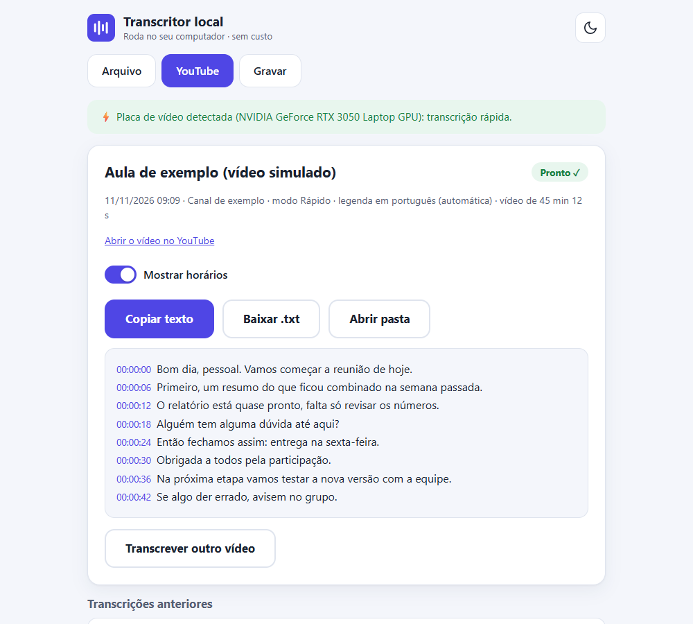
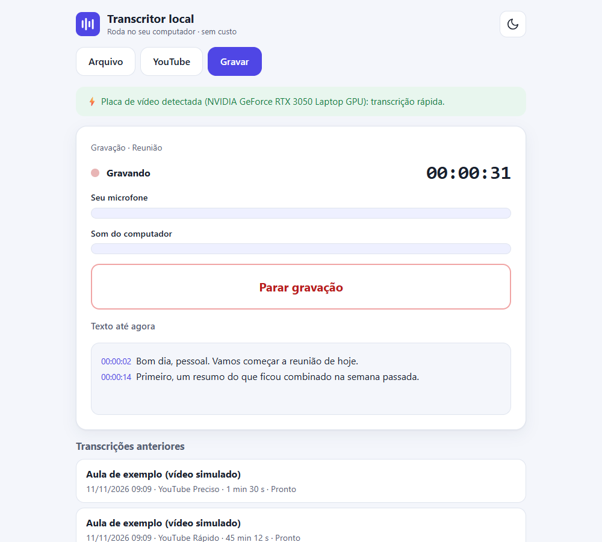
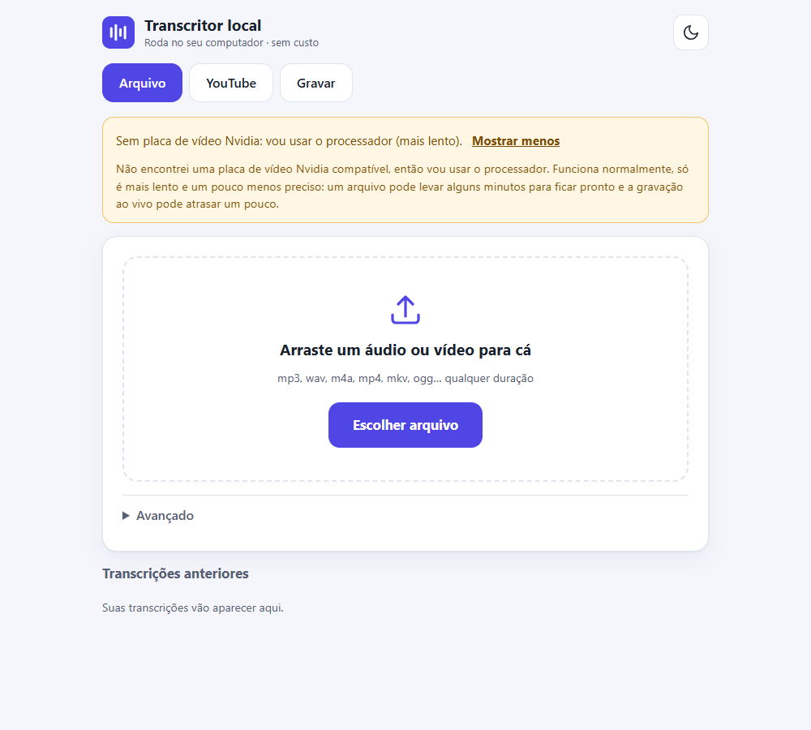
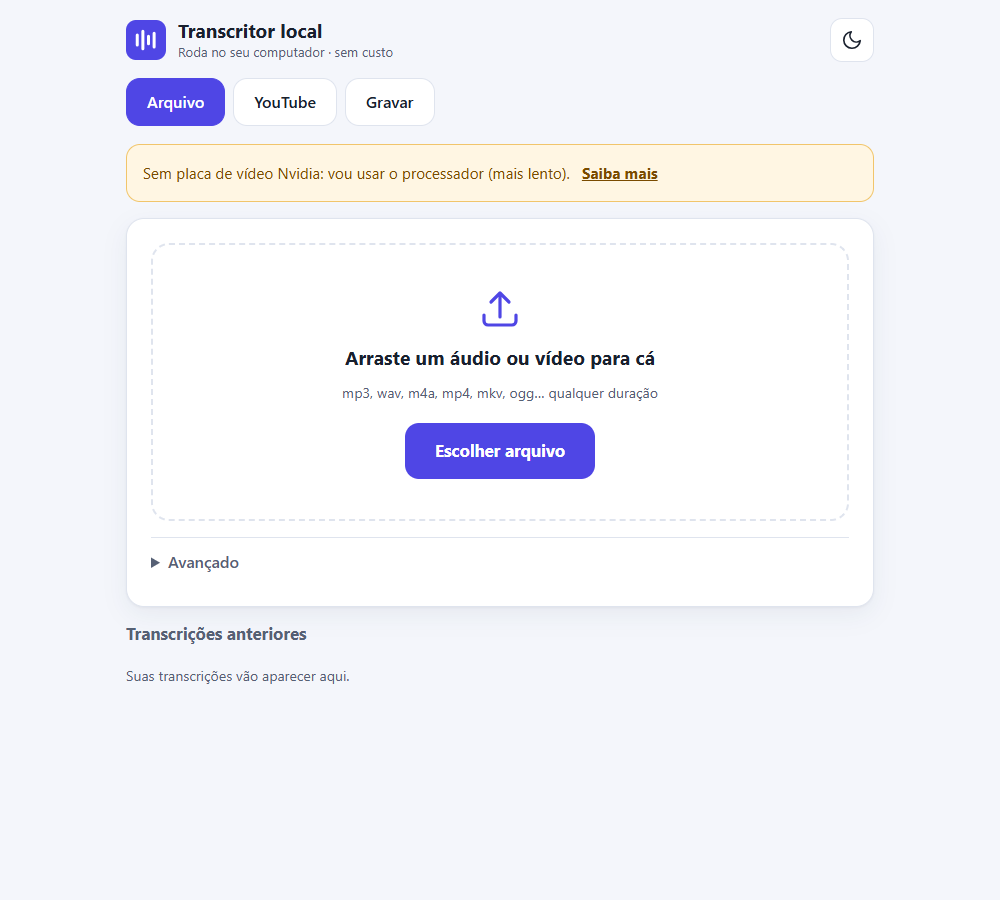
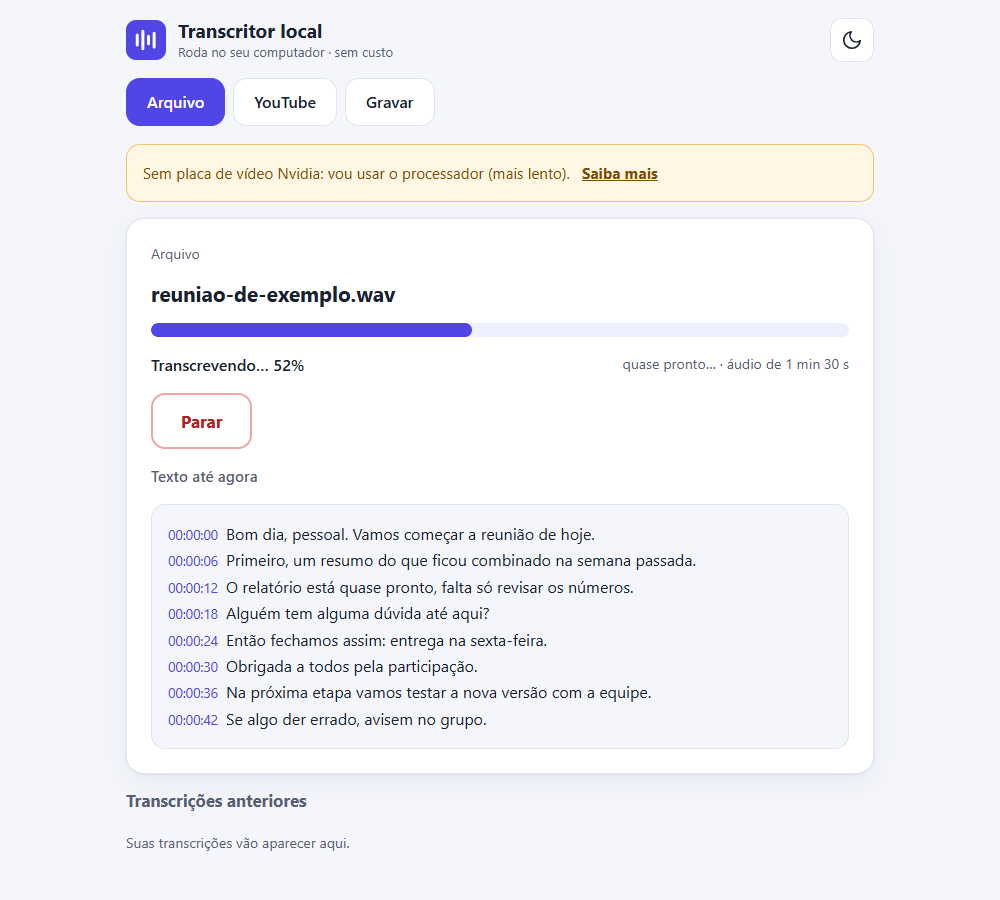
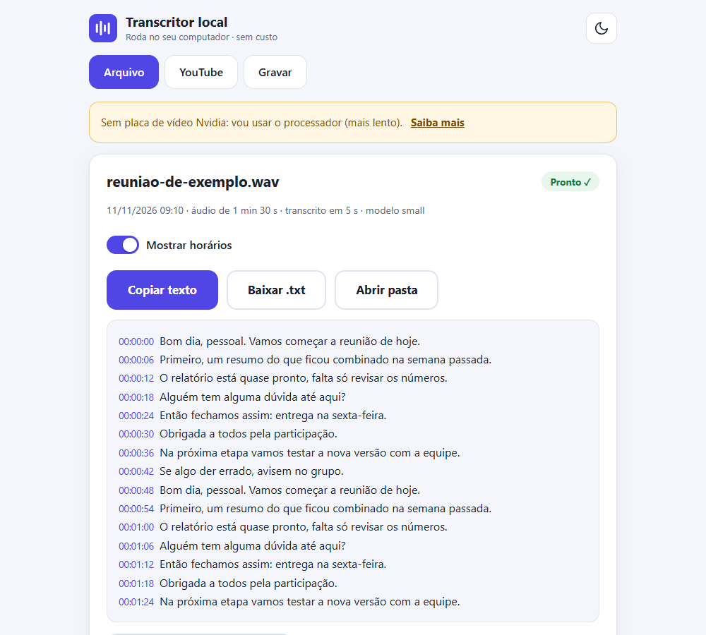
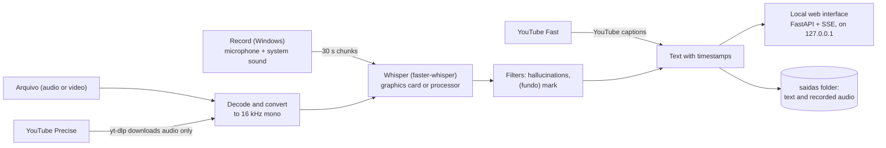

# transcritor-local

**100% local** audio, video and meeting transcription: no API, no subscription, no cost. It runs Whisper
(through [`faster-whisper`](https://github.com/SYSTRAN/faster-whisper)) on your own PC, with a simple web interface
(the interface itself is in Brazilian Portuguese).

> Versão em português: [README.md](README.md)

<p align="center">
  
</p>

*With an Nvidia graphics card the program uses the most accurate model and runs much faster. Without one it works on the
processor (see [Does it work without a graphics card?](#does-it-work-without-a-graphics-card)). The screenshots in this
README use **simulated data** (invented sentences and synthetic audio), generated by
[`scripts/capturar_prints.py`](scripts/capturar_prints.py).*

**Project status**

| | |
|---|---|
| ✅ Tested | the **Arquivo** (File) and **YouTube** tabs, the interface, the engine and the automated tests (synthetic audio) |
| ✅ Tested with simulated capture only | the **Gravar** (Record) tab (levels, chunks, lag, saved audio, device errors) |
| ⏳ **Pending** | **Recording with a real microphone and real system sound**: not yet confirmed on real hardware |

## Contents

[The 3 features](#the-3-features) · [Requirements](#requirements) · [Install](#install-in-3-steps) ·
[Without a graphics card](#does-it-work-without-a-graphics-card) · [How to use](#how-to-use) · [How it works](#how-it-works) ·
[Limitations](#limitations) · [Responsible use](#responsible-use) · [Third-party licenses](#third-party-licenses) · [Contributing](#contributing)

## The 3 features

### Arquivo (File)
Drag in an audio or video file (mp3, wav, m4a, mp4, mkv, ogg… any length). You see the progress, the time left and the text
as it appears, and you can stop at any moment (what was already transcribed is kept).



### YouTube
Paste a video link. **Fast** mode reads the captions YouTube itself shows. **Precise** mode downloads only the audio,
transcribes it with Whisper and, by default, **deletes the audio when done**.



### Gravar (Record)
Records live and shows the text in 30 s chunks. The **Reunião** (Meeting) source captures system sound plus the microphone
(works for Meet, Zoom and Teams); **Ambiente** (Room) captures the microphone only. The original audio is saved in 10-minute blocks.



> ⏳ **Pending:** the Record tab was tested with simulated capture only. The test with a real microphone and real system
> sound has not been done yet; until it is confirmed, treat it as experimental.

## Requirements

| | Minimum (**estimate**) | Recommended |
|---|---|---|
| System | 64-bit Windows 10 or 11 (tested on 11 only) | Windows 11 |
| Python | 3.12 (used in development; other versions not tested) | 3.12 |
| Processor | 4 cores | 8 cores or more |
| Memory (RAM) | 8 GB | 16 GB |
| Graphics card | not required | Nvidia with 4 GB of memory or more |
| Disk | a few GB free (libraries + `small` model, ≈ 0.5 GB) | a few more GB with a graphics card (CUDA libraries + `large-v3-turbo` model, ≈ 1.6 GB) |
| Internet | only to install, download the model the first time and use YouTube | same |

The minimum is an **estimate**, not a measurement on a 4-core PC (see below). Linux and macOS: the File and YouTube tabs
should work but **have not been tested**; the Record tab exists on Windows only.

### Measured speed

Measured on 2026-11-09 on the development laptop: Intel Core i5-13420H (8 cores, 12 threads), 15.7 GB of RAM,
NVIDIA GeForce RTX 3050 Laptop (4 GB). Test audio: 173 s of clean synthetic Portuguese speech.

| Model | Device | 173 s file | Speed | Live 30 s chunk (average / worst) |
|---|---|---|---|---|
| `large-v3-turbo` | Graphics card | 6.5 s | **26.4× real time** | 1.2 s / 1.6 s |
| `small` | Processor | 45.7 s | **3.8× real time** | 8.9 s / 10.4 s |
| `base` | Processor | 17.0 s | **10.2× real time** | 3.7 s / 4.1 s |

"N× real time" = how many seconds of audio are transcribed per second of processing.

**Estimate for the minimum requirement (4 cores).** I limited Whisper to 4 threads on the same laptop:

| Model | Threads | 173 s file | Speed | Live 30 s chunk (average / worst) |
|---|---|---|---|---|
| `small` | 4 | 56.7 s | **3.1× real time** | 13.2 s / 15.1 s |
| `base` | 4 | 24.4 s | **7.1× real time** | 4.4 s / 6.1 s |

**Caveats:**

- Limiting threads simulates the *number* of cores, not their *speed*. An older or entry-level 4-core CPU will probably be
  **slower** than these numbers (and 8 GB of RAM was not simulated either). Read them as the "best case" of the minimum.
- The numbers use **clean synthetic speech**; real speech with noise, accents or several people can be slower and less accurate.
- They hold for **this laptop**, not for weaker PCs.
- On the processor, **small models make more mistakes and invent more** over noise (see [Limitations](#limitations)).

Details and method in [`docs/benchmark.md`](docs/benchmark.md) (in Portuguese).

## Install in 3 steps

Tested on Windows 11. Commands are for **PowerShell**.

**1. Install Python 3.12** from [python.org](https://www.python.org/downloads/) and get this project
(`git clone https://github.com/Giovani-fr/transcritor-local` or "Download ZIP").

**2. Create the environment and install the dependencies** (inside the project folder). The environment lives outside the
project folder on purpose, so it is not synced if the folder is inside OneDrive:

```powershell
py -3.12 -m venv "$env:USERPROFILE\venvs\transcritor-local"
& "$env:USERPROFILE\venvs\transcritor-local\Scripts\pip" install -r requirements.txt
```

If the PC has an **Nvidia graphics card** (with an up-to-date driver), also install the CUDA libraries so it gets used:

```powershell
& "$env:USERPROFILE\venvs\transcritor-local\Scripts\pip" install -r requirements-gpu.txt
```

Without an Nvidia card, **skip this command**: the program uses the processor on its own.

**3. Start the program:** double-click `iniciar.bat`. It opens your browser at `http://127.0.0.1:8765`.
The first time, the screen asks you to download the model (**Baixar e começar** button; ≈ 0.5 GB on the processor,
≈ 1.6 GB with a graphics card).

The program only serves your own computer (`127.0.0.1`): nobody on your network can open it.

## Does it work without a graphics card?

**Yes.** The program detects that there is no compatible Nvidia card, warns you in one line and uses the processor with the
`small` model. It is slower (about 3 to 4× real time on this laptop: a 1-hour meeting is done in roughly 16 to 20 min) and a
little less accurate. Live recording keeps up as long as each 30 s chunk takes well under 30 s to process; if it falls
behind, a lag indicator appears.

The notice is shown open the first time and collapsed afterwards ("Saiba mais" shows the details):

<p>
  
  
</p>
<p>
  
  
</p>

## How to use

### Arquivo (File)
1. Open the **Arquivo** tab and drag in the audio or video (or click **Escolher arquivo**).
2. Follow the progress. **Parar** (Stop) interrupts and keeps what was already transcribed.
3. In the result: **Copiar texto** (copy), **Baixar .txt** (download) or **Abrir pasta** (open folder). The **Mostrar horários**
   switch turns timestamps on and off.
4. Under **Avançado** (Advanced) you can pick the language (Portuguese, English, Spanish or auto-detect).
5. Earlier transcripts are listed under "Transcrições anteriores" on the same screen.

### YouTube
1. Open the **YouTube** tab, paste the link and click **Buscar vídeo** (find video).
2. Choose **Rápido** (Fast: uses YouTube's captions; instant, but only works if the video has captions) or **Preciso**
   (Precise: downloads the audio and transcribes it with Whisper; works for videos without captions).
3. The downloaded audio is **deleted when done**, unless you tick the option to keep it.
4. If the download fails, it is almost always because `yt-dlp` is out of date after a YouTube change. The program shows an
   **Atualizar yt-dlp agora** (update yt-dlp now) button, which installs only after you confirm ("Vou instalar a versão mais
   recente do yt-dlp. Continuar?") and shows the version before and after. A command to copy is also there if you prefer to update by hand.

### Gravar (Record)
1. Open the **Gravar** tab. The level meters show, before recording, whether sound is arriving (nothing is recorded at this point).
2. Choose **Reunião** (system sound + microphone) or **Ambiente** (microphone only). Under **Avançado** you pick the microphone.
3. In Reunião mode a reminder appears to **tell the participants** that the meeting will be recorded and transcribed.
4. Click **Iniciar gravação** (start). Text appears in 30 s chunks; quieter speech gets a "(fundo)" (background) mark.
   If the sound is too low or silent, the program warns you.
5. **Parar gravação** (stop) finishes and processes the last piece. The original audio stays in the recording's folder,
   in 10-minute blocks, and is never deleted.

> ⏳ **Pending:** this flow has not yet been confirmed with a real microphone and real system sound.

The light/dark theme follows the system (and there is a button to switch), and the layout adapts to narrow windows.

## How it works



- **Engine:** `faster-whisper` with the `large-v3-turbo` model on an Nvidia card, or `small` on the processor (`base` if there
  is less than 6 GB of RAM). Audio is normalized only for Whisper; the original file is never changed.
- **Record:** captures the microphone and system sound through WASAPI (the `PyAudioWPatch` library), converts to 16 kHz mono,
  saves a `.wav` in 10-minute blocks and sends 30 s chunks to Whisper on another thread.
- **Interface:** local FastAPI server; the browser receives progress through events (SSE). The front end is plain HTML, CSS and
  JavaScript, with no build step.
- **Network:** the program uses the internet only to download the model (Hugging Face) the first time, for the YouTube tab and
  to update `yt-dlp`. The transcription itself runs entirely on your computer.
- **Privacy:** audio, videos and transcripts stay in the `saidas/` folder, which is in `.gitignore`.

Layout: `src/transcritor/` (engine, service, capture, YouTube, web), `tests/`, `docs/` (screenshots and measurements),
`scripts/capturar_prints.py`.

## Limitations

- **No speaker separation:** the text comes out as one stream, without "Person 1 / Person 2".
- **Live recording is Windows-only** (WASAPI capture). On other systems the Record tab says it is unavailable.
- **Recording has not yet been tested with a real microphone and real system sound** (see the project status at the top).
- **Small models hallucinate more on the processor.** Over noise, `base` invented "E aí!" and `small` once invented a subtitle
  credit (now filtered) in tests with synthetic noise; the graphics card with `large-v3-turbo` invented nothing. The filter
  drops known hallucinations, but short, plausible phrases can still get through.
- **On the processor, recording can lag** on weaker PCs; the program shows a lag indicator.
- **Quality depends on the audio:** noise, strong accents, music or several people talking at once make results worse.
- **Speed measurements** hold for one laptop (i5-13420H + RTX 3050); the 4-core minimum is an estimate.
- **YouTube:** can break when YouTube changes. Updating `yt-dlp` usually fixes it. Fast mode only works if the video has captions.
- The interface is in **Brazilian Portuguese** only.

## Responsible use

- **Personal use.** This program is meant for personal use, for example transcribing your own lectures, meetings and
  videos you need notes from. Do not use it to copy, republish or redistribute other people's content.
- **YouTube.** Respect the [YouTube Terms of Service](https://www.youtube.com/t/terms) and the copyright of whoever
  published the video. Fast mode reads the captions YouTube itself shows; Precise mode downloads the audio only to
  transcribe it and, by default, **deletes the file when done**. Do not download or transcribe videos where the
  platform's terms or your country's law forbid it.
- **Recordings and meetings.** Tell people and get their consent before recording a conversation or meeting. The program
  shows a reminder before starting a recording in Reunião mode, but the responsibility is yours.
- **Tests.** The automated tests use no third-party videos: they use synthetic audio and simulations. The only test that
  needs the internet (`pytest -m rede`, optional) uses a NASA video, generally public-domain material.
- **Example video.** The video used in this project's examples and in the optional internet test is from **NASA Goddard**
  (public domain, unless otherwise noted). The screenshots in this README use simulated data.

## Third-party licenses

This project is under the [MIT](LICENSE) license. It depends on other projects, each with its own license (check each
repository; the information below is what the installed packages declare):

| Component | Used for | License |
|---|---|---|
| [Whisper](https://github.com/openai/whisper) (OpenAI), models | speech recognition | MIT |
| [faster-whisper](https://github.com/SYSTRAN/faster-whisper) and [CTranslate2](https://github.com/OpenNMT/CTranslate2) | inference engine | MIT |
| [yt-dlp](https://github.com/yt-dlp/yt-dlp) | downloading YouTube audio | Unlicense |
| [youtube-transcript-api](https://github.com/jdepoix/youtube-transcript-api) | reading YouTube captions | MIT |
| [PyAudioWPatch](https://github.com/s0d3s/PyAudioWPatch) | audio capture (WASAPI) | Apache-2.0 |
| [FastAPI](https://github.com/fastapi/fastapi) and [uvicorn](https://github.com/encode/uvicorn) | interface server | MIT and BSD-3-Clause |
| [PyAV](https://github.com/PyAV-Org/PyAV), [NumPy](https://numpy.org), [SciPy](https://scipy.org) | audio and math | BSD |
| [Hugging Face Hub](https://github.com/huggingface/huggingface_hub) | downloading the models | Apache-2.0 |
| NVIDIA cuBLAS and cuDNN (`requirements-gpu.txt`, optional) | graphics-card acceleration | NVIDIA proprietary license (not open source; installed only if you ask) |
| [Playwright](https://github.com/microsoft/playwright-python) (`requirements-dev.txt` only) | generating the screenshots | Apache-2.0 |

The program does not bundle any of these components: they are installed by `pip` on your machine.

## Contributing

Contributions are welcome (issues and pull requests). To run the project in development mode:

```powershell
& "$env:USERPROFILE\venvs\transcritor-local\Scripts\pip" install -r requirements-dev.txt
& "$env:USERPROFILE\venvs\transcritor-local\Scripts\python" -m pytest
```

- Tests use synthetic audio and simulations. A few use the real `small` model (downloads ≈ 0.5 GB the first time):
  `pytest -m "not modelo"` runs only the fast ones. `pytest -m rede` runs the optional internet test.
- To try the Record tab without a microphone: `TRANSCRITOR_CAPTURA_SIMULADA=1` uses synthetic signals.
- To regenerate the screenshots: `python -m playwright install chromium` and `python -I -X utf8 scripts/capturar_prints.py`.
- **Privacy:** do not post real audio, recordings or transcripts in issues, pull requests or screenshots.
  Use synthetic audio or public-domain content.
- Keep interface messages in plain Portuguese, without jargon.
