# transcritor-local

Transcrição de áudio, vídeo e reuniões **100% local**: sem API, sem assinatura e sem custo. Usa o Whisper
(via [`faster-whisper`](https://github.com/SYSTRAN/faster-whisper)) no seu próprio PC, com uma interface web simples em português.

> English version: [README.en.md](README.en.md)

<p align="center">
  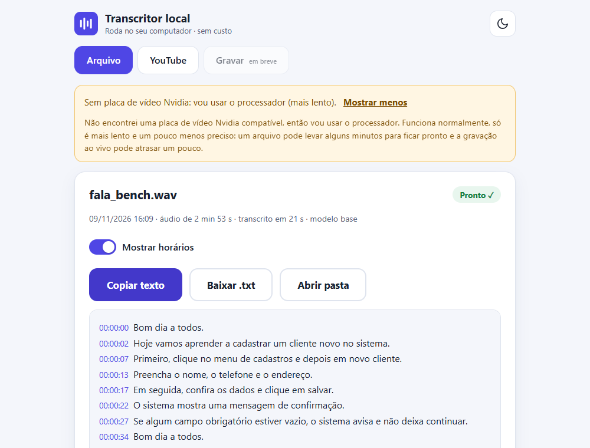
</p>

*Com placa de vídeo Nvidia o programa usa o modelo mais preciso e roda bem mais rápido. Sem placa, funciona no
processador (veja [Funciona sem placa de vídeo?](#funciona-sem-placa-de-vídeo)). Os prints deste README usam **dados simulados**
(frases inventadas e áudio sintético), gerados por [`scripts/capturar_prints.py`](scripts/capturar_prints.py).*

**Estado do projeto**

| | |
|---|---|
| ✅ Testado | abas **Arquivo** e **YouTube**, a interface, o motor e os testes automáticos (com áudio sintético) |
| ✅ Testado só com captura simulada | aba **Gravar** (níveis, trechos, atraso, áudio salvo, erros de dispositivo) |
| ⏳ **Pendente** | **Gravar com microfone e som do sistema reais**: ainda não foi confirmado no hardware real |

## Sumário

[As 3 funções](#as-3-funções) · [Requisitos](#requisitos) · [Instalação](#instalação-em-3-passos) ·
[Sem placa de vídeo](#funciona-sem-placa-de-vídeo) · [Como usar](#como-usar) · [Como funciona](#como-funciona-por-baixo) ·
[Limitações](#limitações) · [Uso responsável](#uso-responsável) · [Licenças](#licenças-de-terceiros) · [Contribuir](#contribuir)

## As 3 funções

### Arquivo
Arraste um áudio ou vídeo (mp3, wav, m4a, mp4, mkv, ogg…, qualquer duração). Você acompanha o progresso, o tempo restante
e o texto aparecendo, e pode parar quando quiser (o que já foi transcrito fica salvo).

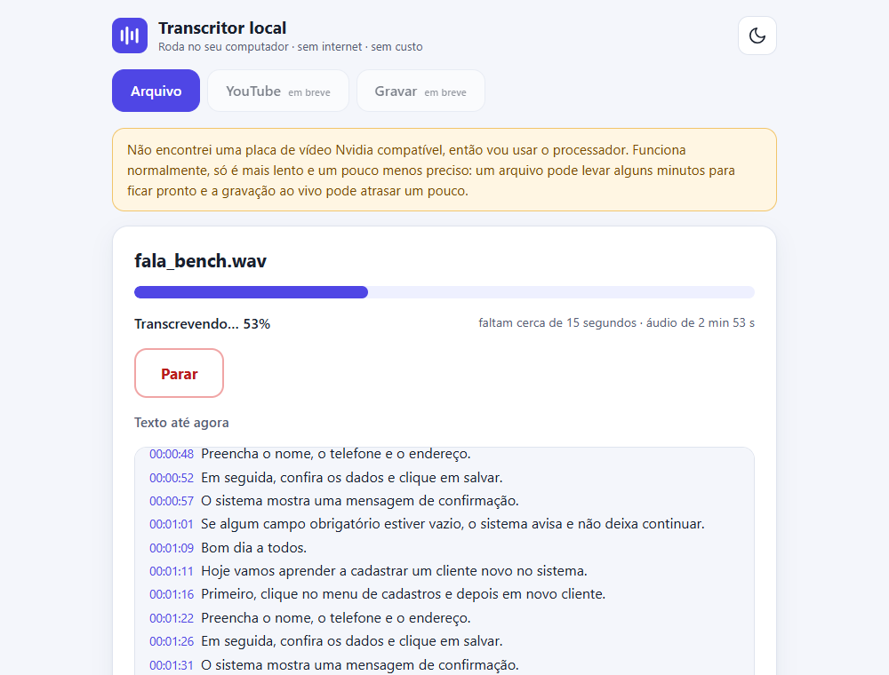

### YouTube
Cole o link de um vídeo. No modo **Rápido** o programa lê as legendas que o próprio YouTube mostra. No modo **Preciso**
baixa só o áudio, transcreve com o Whisper e, por padrão, **apaga o áudio ao terminar**.

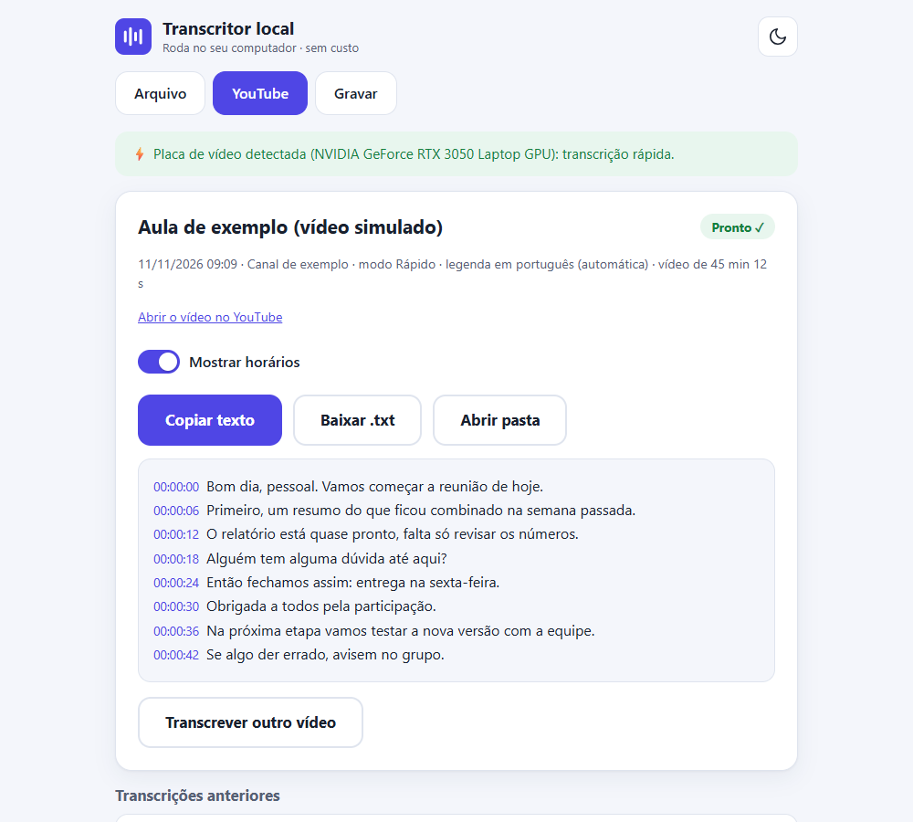

### Gravar
Grava ao vivo e mostra o texto por trechos de 30 s. A fonte **Reunião** capta o som do computador mais o microfone
(serve para Meet, Zoom e Teams); **Ambiente** capta só o microfone. O áudio original é guardado em blocos de 10 min.

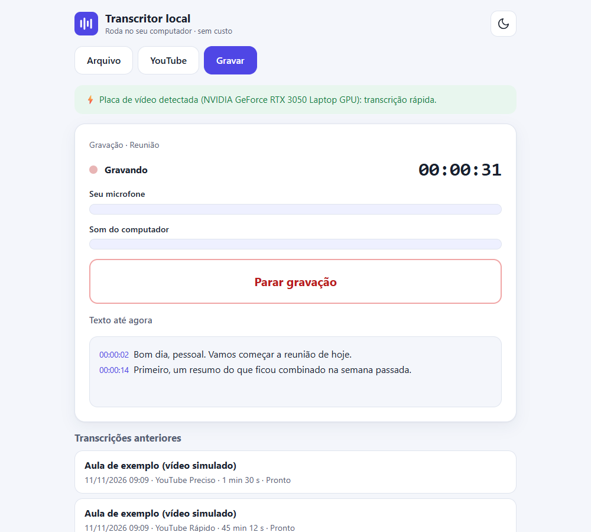

> ⏳ **Pendente:** a aba Gravar foi testada só com captura simulada. O teste com microfone e som do sistema reais
> ainda não foi feito; até ser confirmado, trate-a como experimental.

## Requisitos

| | Mínimo (**estimativa**) | Recomendado |
|---|---|---|
| Sistema | Windows 10 ou 11 de 64 bits (testado só no 11) | Windows 11 |
| Python | 3.12 (usado no desenvolvimento; outras versões não foram testadas) | 3.12 |
| Processador | 4 núcleos | 8 núcleos ou mais |
| Memória (RAM) | 8 GB | 16 GB |
| Placa de vídeo | não é obrigatória | Nvidia com 4 GB de memória ou mais |
| Disco | ≈ 1 GB livre (bibliotecas ≈ 0,6 GB + modelo `small`, ≈ 0,5 GB) | ≈ 4 GB com a placa de vídeo (bibliotecas CUDA ≈ 2 GB + modelo `large-v3-turbo`, ≈ 1,6 GB) |
| Internet | só para instalar, baixar o modelo na primeira vez e usar o YouTube | idem |

O mínimo é uma **estimativa**, não uma medição em um PC de 4 núcleos (veja abaixo). Linux e macOS: as abas Arquivo e YouTube
devem funcionar, mas **não foram testadas**; a aba Gravar só existe no Windows.

### Velocidade medida

Medido em 2026-11-09 no notebook de desenvolvimento: Intel Core i5-13420H (8 núcleos, 12 threads), 15,7 GB de RAM,
NVIDIA GeForce RTX 3050 Laptop (4 GB). Áudio de teste: 173 s de fala sintética em português, limpa.

| Modelo | Dispositivo | Arquivo de 173 s | Velocidade | Trecho ao vivo de 30 s (média / pior) |
|---|---|---|---|---|
| `large-v3-turbo` | Placa de vídeo | 6,5 s | **26,4× tempo real** | 1,2 s / 1,6 s |
| `small` | Processador | 45,7 s | **3,8× tempo real** | 8,9 s / 10,4 s |
| `base` | Processador | 17,0 s | **10,2× tempo real** | 3,7 s / 4,1 s |

"N× tempo real" = quantos segundos de áudio são transcritos por segundo de processamento.

**Estimativa para o requisito mínimo (4 núcleos).** Limitei o Whisper a 4 threads no mesmo notebook:

| Modelo | Threads | Arquivo de 173 s | Velocidade | Trecho ao vivo de 30 s (média / pior) |
|---|---|---|---|---|
| `small` | 4 | 56,7 s | **3,1× tempo real** | 13,2 s / 15,1 s |
| `base` | 4 | 24,4 s | **7,1× tempo real** | 4,4 s / 6,1 s |

**Ressalvas:**

- Limitar threads simula a *quantidade* de núcleos, não a *velocidade* deles. Uma CPU de 4 núcleos mais antiga ou de entrada
  provavelmente será **mais lenta** que estes números (e a RAM de 8 GB também não foi simulada). Leia como o "melhor caso" do mínimo.
- Os números usam **fala sintética limpa**; fala real, com ruído, sotaques ou várias pessoas, pode ser mais lenta e menos precisa.
- Valem para **este notebook**, não para PCs mais fracos.
- Em processador, **modelos pequenos erram e inventam mais** sobre ruído (veja [Limitações](#limitações)).

Detalhes e método em [`docs/benchmark.md`](docs/benchmark.md).

## Instalação em 3 passos

Testado no Windows 11. Os comandos são para o **PowerShell**.

**1. Instale o Python 3.12** em [python.org](https://www.python.org/downloads/) e baixe este projeto
(`git clone https://github.com/Giovani-fr/transcritor-local` ou "Download ZIP").

**2. Crie o ambiente e instale as dependências** (dentro da pasta do projeto). O ambiente fica fora da pasta do projeto
de propósito, para não ser sincronizado se ela estiver no OneDrive:

```powershell
py -3.12 -m venv "$env:USERPROFILE\venvs\transcritor-local"
& "$env:USERPROFILE\venvs\transcritor-local\Scripts\pip" install -r requirements.txt
```

Se o PC tem **placa de vídeo Nvidia** (com o driver atualizado), instale também as bibliotecas CUDA para ela ser usada
(baixa cerca de 2 GB e pode levar vários minutos):

```powershell
& "$env:USERPROFILE\venvs\transcritor-local\Scripts\pip" install -r requirements-gpu.txt
```

Sem placa Nvidia, **pule este comando**: o programa usa o processador sozinho.

Se você tem placa Nvidia e esqueceu este comando (ou o driver está antigo), o programa percebe: mostra o aviso
*"Encontrei sua placa Nvidia, mas faltam as bibliotecas para usá-la. Rode: `pip install -r requirements-gpu.txt`"*, com o
botão **Copiar comando**, e enquanto isso usa o processador. Só diz *"não encontrei placa Nvidia"* quando não há placa.

**3. Abra o programa:** dê dois cliques em `iniciar.bat`. Ele abre o navegador em `http://127.0.0.1:8765`.
Para fechar, aperte **Ctrl+C** na janela preta (se ela perguntar *"Deseja finalizar o arquivo em lotes (S/N)?"*, responda **S**).
Se o programa cair por um erro grave, o `iniciar.bat` o abre de novo sozinho (até 5 vezes); fechar de propósito nunca o reinicia.
Na primeira vez a tela pede para baixar o modelo (botão **Baixar e começar**; ≈ 0,5 GB no processador, ≈ 1,6 GB com placa de vídeo).

O programa só atende o seu próprio computador (`127.0.0.1`): ninguém na sua rede consegue abrir.

## Funciona sem placa de vídeo?

**Funciona.** O programa detecta que não há placa Nvidia compatível, avisa em uma linha e usa o processador com o modelo
`small`. É mais lento (cerca de 3 a 4× o tempo real neste notebook: uma reunião de 1 hora fica pronta em uns 16 a 20 min) e um
pouco menos preciso. A gravação ao vivo acompanha enquanto cada trecho de 30 s demorar bem menos que 30 s para ser processado;
se ficar para trás, aparece um indicador de atraso.

Dica: com placa de vídeo, **Avançado → "Usar o processador mesmo com placa de vídeo"** (desligado por padrão) força o
processador, útil se a placa der problema. Na primeira vez isso pode pedir para baixar o modelo menor (≈ 0,5 GB).

O aviso aparece aberto na primeira vez e fica recolhido depois ("Saiba mais" mostra o detalhe):

<p>
  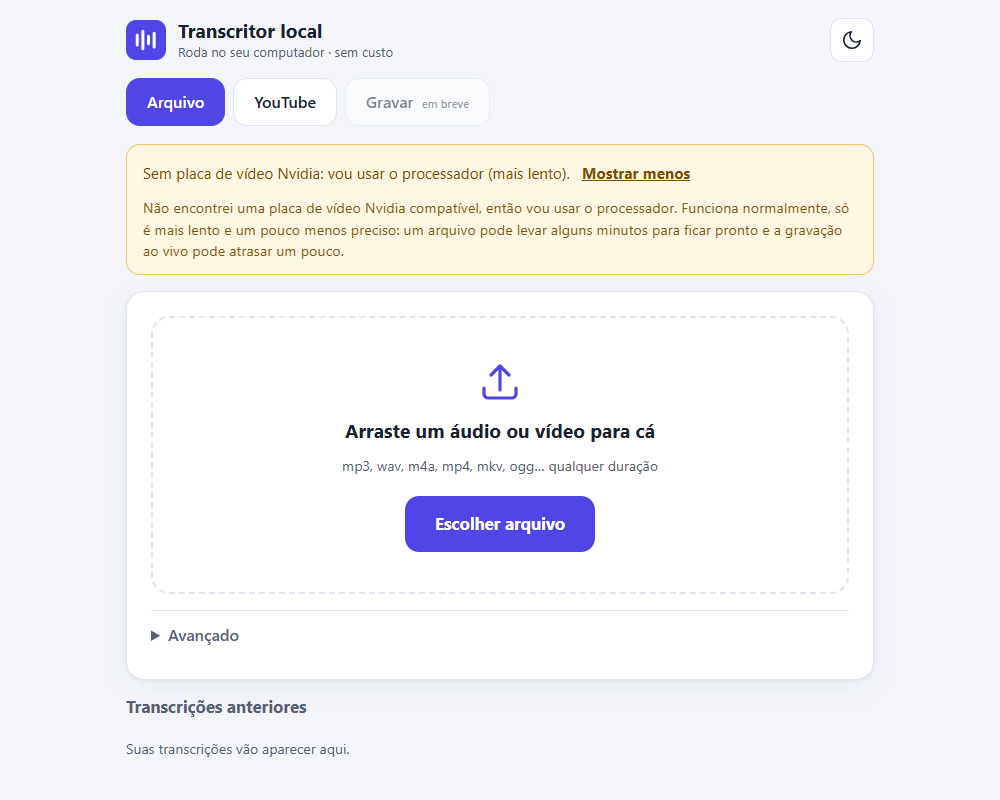
  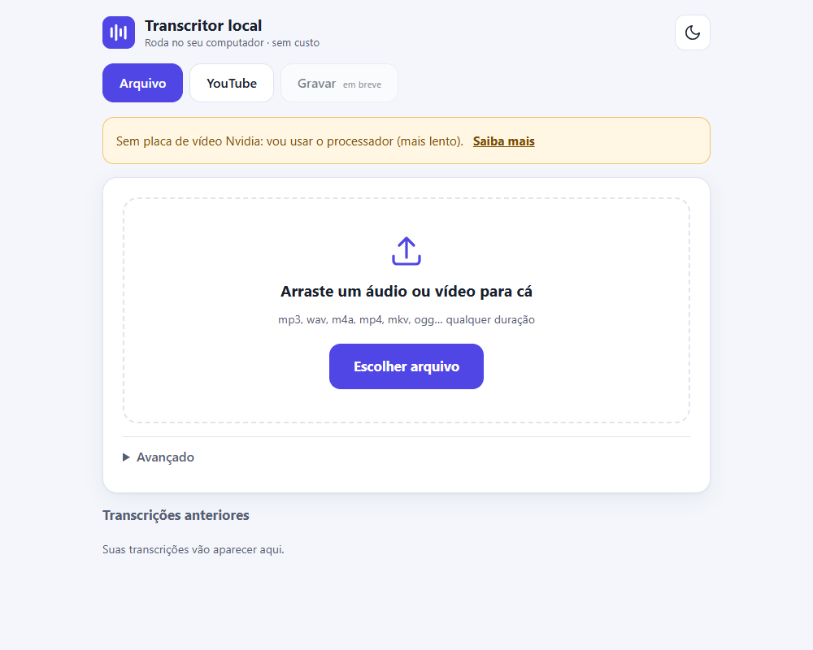
</p>
<p>
  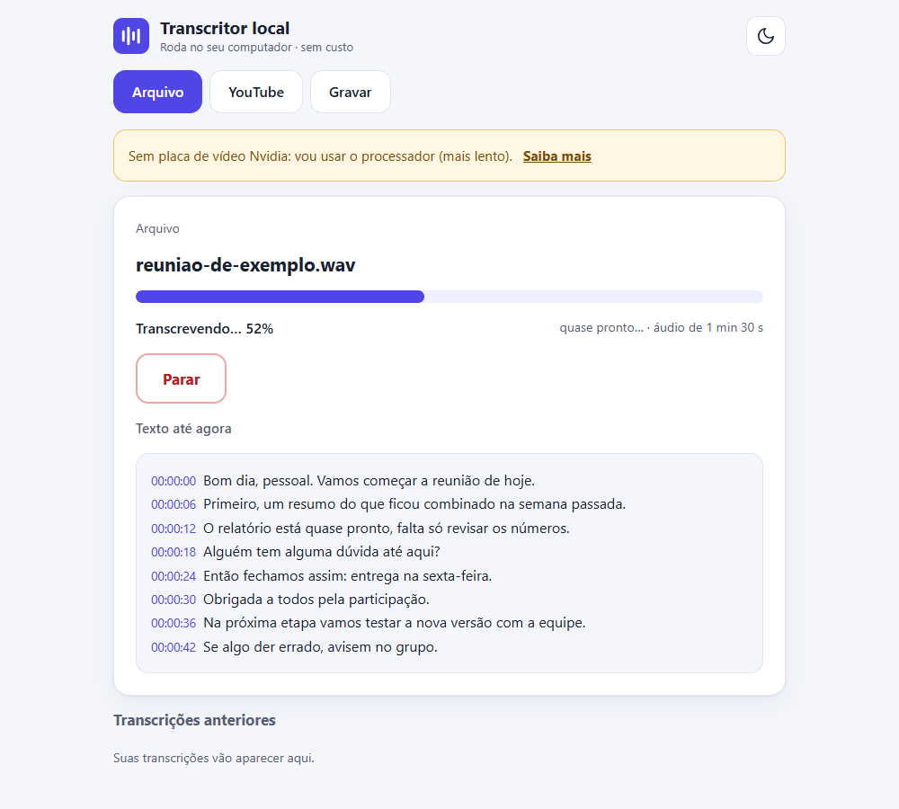
  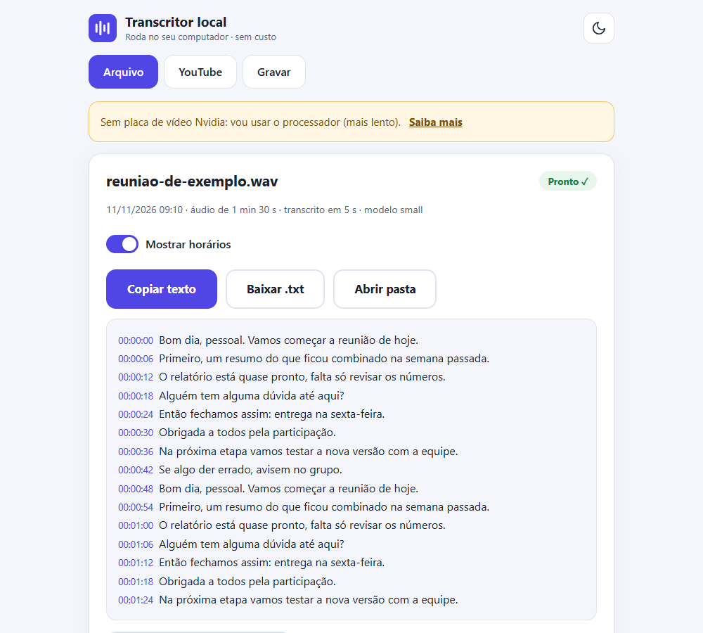
  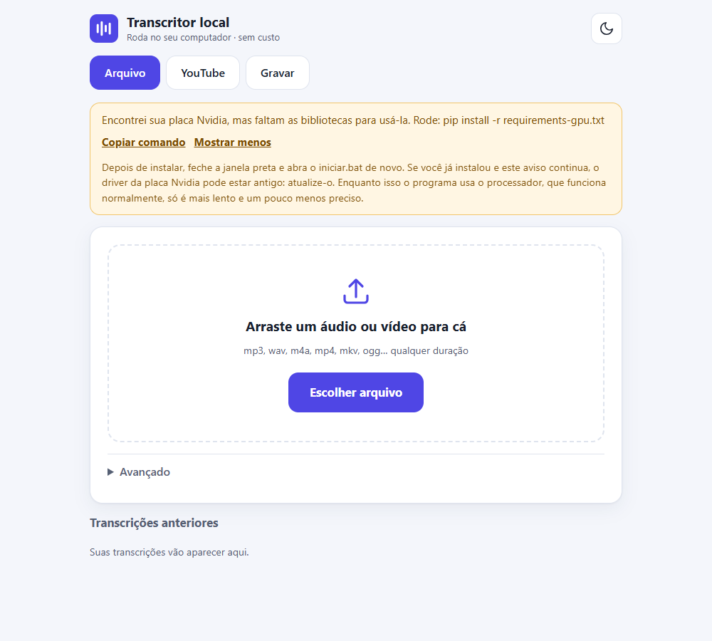
  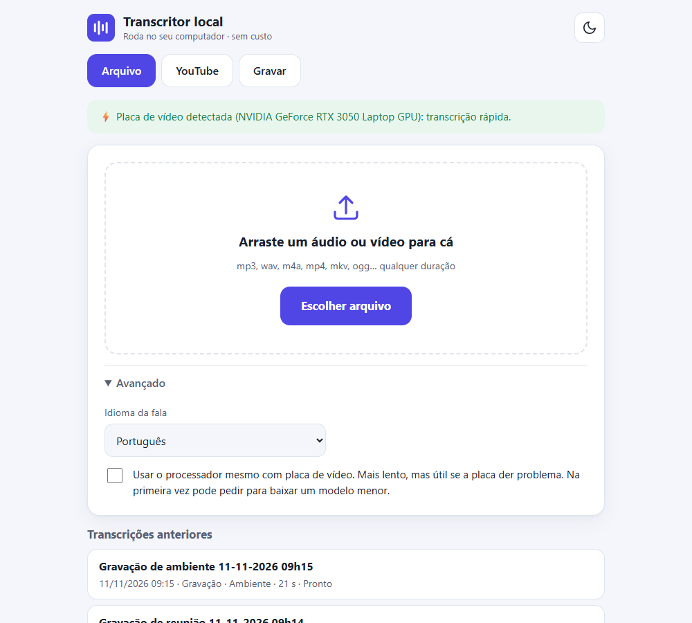
</p>

## Como usar

### Arquivo
1. Abra a aba **Arquivo** e arraste o áudio ou vídeo (ou clique em **Escolher arquivo**).
2. Acompanhe o progresso. **Parar** interrompe e guarda o que já foi transcrito.
3. No resultado: **Copiar texto**, **Baixar .txt** ou **Abrir pasta**. A chave **Mostrar horários** liga e desliga os horários.
4. Em **Avançado** dá para escolher o idioma (português, inglês, espanhol ou detectar sozinho).
5. As transcrições anteriores ficam em "Transcrições anteriores", na mesma tela.

### YouTube
1. Abra a aba **YouTube**, cole o link e clique em **Buscar vídeo**.
2. Escolha **Rápido** (usa as legendas do YouTube; é imediato, mas só funciona se o vídeo tiver legendas) ou **Preciso**
   (baixa o áudio e transcreve com o Whisper; serve para vídeos sem legenda).
3. O áudio baixado é **apagado ao terminar**, a menos que você marque a opção de guardá-lo.
4. Se o download falhar, quase sempre o `yt-dlp` está desatualizado porque o YouTube mudou. O programa mostra o botão
   **Atualizar yt-dlp agora**, que só instala depois de você confirmar ("Vou instalar a versão mais recente do yt-dlp.
   Continuar?") e mostra a versão antes e depois. Também há o comando para copiar, se você preferir atualizar sozinho.

### Gravar
1. Abra a aba **Gravar**. Os medidores de nível mostram, antes de gravar, se o som está chegando (nada é gravado nesse momento).
2. Escolha **Reunião** (som do computador + microfone) ou **Ambiente** (só o microfone). Em **Avançado** você escolhe o microfone.
3. No modo Reunião aparece um lembrete para **avisar os participantes** de que a reunião será gravada e transcrita.
4. Clique em **Iniciar gravação**. O texto aparece por trechos de 30 s; falas mais baixas levam a marca "(fundo)".
   Se o som ficar baixo ou mudo, o programa avisa.
5. **Parar gravação** termina e processa o último pedaço. O áudio original fica salvo na pasta da gravação, em blocos de 10 min,
   e nunca é apagado.

> ⏳ **Pendente:** este fluxo ainda não foi confirmado com microfone e som do sistema reais.

O tema claro/escuro segue o do sistema (e há um botão para trocar), e o layout se adapta a janelas estreitas.

## Como funciona por baixo

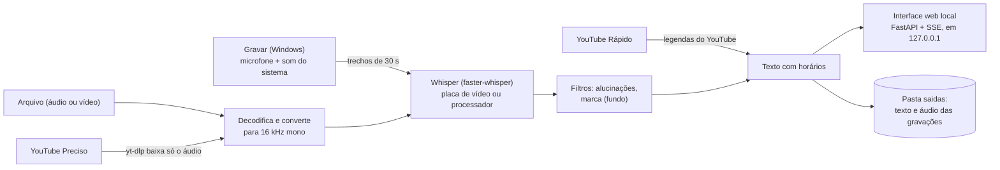

- **Motor:** `faster-whisper` com o modelo `large-v3-turbo` na placa Nvidia ou `small` no processador (`base` se houver
  menos de 6 GB de RAM). O áudio é normalizado só para o Whisper; o arquivo original não é alterado.
- **Gravar:** capta o microfone e o som do sistema por WASAPI (biblioteca `PyAudioWPatch`), converte para 16 kHz mono,
  guarda um `.wav` em blocos de 10 min e envia trechos de 30 s para o Whisper em outra thread.
- **Interface:** servidor FastAPI local; o navegador recebe o progresso por eventos (SSE). O front-end é HTML, CSS e JavaScript
  puros, sem etapa de build.
- **Rede:** o programa só usa a internet para baixar o modelo (Hugging Face) na primeira vez, para a aba YouTube e para
  atualizar o `yt-dlp`. A transcrição em si roda toda no seu computador.
- **Privacidade:** áudio, vídeos e transcrições ficam na pasta `saidas/` e estão no `.gitignore`.

Estrutura: `src/transcritor/` (motor, serviço, captura, YouTube, web), `tests/`, `docs/` (prints e medições),
`scripts/capturar_prints.py`.

## Limitações

- **Não separa falantes:** o texto sai corrido, sem "Pessoa 1 / Pessoa 2".
- **Gravação ao vivo só no Windows** (captura WASAPI). Em outros sistemas a aba Gravar avisa que não está disponível.
- **Gravar ainda não foi testada com microfone e som do sistema reais** (veja o estado do projeto, no começo).
- **Modelos pequenos alucinam mais em processador.** Sobre ruído, o `base` inventou "E aí!" e o `small` já inventou um crédito
  de legenda (hoje filtrado) nos testes com ruído sintético; a placa de vídeo com `large-v3-turbo` não inventou nada. O filtro
  descarta as alucinações conhecidas, mas frases curtas e plausíveis ainda podem passar.
- **Em processador a gravação pode atrasar** em PCs mais fracos; o programa mostra um indicador de atraso.
- **A qualidade depende do áudio:** ruído, sotaque forte, música ou várias pessoas falando juntas pioram o resultado.
- **Medições** de velocidade valem para um notebook (i5-13420H + RTX 3050); o mínimo de 4 núcleos é estimativa.
- **YouTube:** pode quebrar quando o YouTube muda. Atualizar o `yt-dlp` costuma resolver. O modo Rápido só funciona se o
  vídeo tiver legendas.
- A interface está só em **português do Brasil**.

## Uso responsável

- **Uso pessoal.** Este programa é para uso pessoal, por exemplo transcrever suas próprias aulas, reuniões e vídeos
  de que você precisa fazer anotações. Não o use para copiar, republicar ou redistribuir conteúdo de terceiros.
- **YouTube.** Respeite os [Termos de Serviço do YouTube](https://www.youtube.com/t/terms) e os direitos autorais de quem
  publicou o vídeo. O modo Rápido lê as legendas que o próprio YouTube mostra; o modo Preciso baixa o áudio só para
  transcrever e, por padrão, **apaga o arquivo ao terminar**. Não baixe nem transcreva vídeos quando isso for proibido
  pelos termos da plataforma ou pela lei do seu país.
- **Gravações e reuniões.** Avise e peça o consentimento das pessoas antes de gravar uma conversa ou reunião. O programa
  mostra um lembrete antes de iniciar a gravação no modo Reunião, mas a responsabilidade é de quem grava.
- **Testes.** Os testes automáticos não usam vídeos de terceiros: usam áudio sintético e simulações. O único teste com
  internet (`pytest -m rede`, opcional) usa um vídeo da NASA, material em geral de domínio público.
- **Vídeo dos exemplos.** O vídeo que aparece nos exemplos e no teste opcional com internet deste projeto é da
  **NASA Goddard** (domínio público, salvo indicação em contrário). Os prints deste README usam dados simulados.

## Licenças de terceiros

Este projeto usa a licença [MIT](LICENSE). Ele depende de outros projetos, cada um com a sua licença (confira nos
respectivos repositórios; as informações abaixo são as declaradas nos pacotes instalados):

| Componente | Para quê | Licença |
|---|---|---|
| [Whisper](https://github.com/openai/whisper) (OpenAI), modelos | reconhecimento de fala | MIT |
| [faster-whisper](https://github.com/SYSTRAN/faster-whisper) e [CTranslate2](https://github.com/OpenNMT/CTranslate2) | motor de inferência | MIT |
| [yt-dlp](https://github.com/yt-dlp/yt-dlp) | baixar o áudio do YouTube | Unlicense |
| [youtube-transcript-api](https://github.com/jdepoix/youtube-transcript-api) | ler legendas do YouTube | MIT |
| [PyAudioWPatch](https://github.com/s0d3s/PyAudioWPatch) | captura de áudio (WASAPI) | Apache-2.0 |
| [FastAPI](https://github.com/fastapi/fastapi) e [uvicorn](https://github.com/encode/uvicorn) | servidor da interface | MIT e BSD-3-Clause |
| [PyAV](https://github.com/PyAV-Org/PyAV), [NumPy](https://numpy.org), [SciPy](https://scipy.org) | áudio e cálculo | BSD |
| [Hugging Face Hub](https://github.com/huggingface/huggingface_hub) | baixar os modelos | Apache-2.0 |
| NVIDIA cuBLAS e cuDNN (`requirements-gpu.txt`, opcional) | aceleração por placa de vídeo | licença proprietária da NVIDIA (não é código aberto; instalada só se você pedir) |
| [Playwright](https://github.com/microsoft/playwright-python) (só `requirements-dev.txt`) | gerar os prints | Apache-2.0 |

O programa não inclui nenhum desses componentes: eles são instalados por `pip` na sua máquina.

## Contribuir

Contribuições são bem-vindas (issues e pull requests). Para rodar o projeto em modo de desenvolvimento:

```powershell
& "$env:USERPROFILE\venvs\transcritor-local\Scripts\pip" install -r requirements-dev.txt
& "$env:USERPROFILE\venvs\transcritor-local\Scripts\python" -m pytest -m "not modelo and not rede"
```

- Os testes usam áudio sintético e simulações. Alguns usam o modelo `small` de verdade (baixa ≈ 0,5 GB na primeira vez):
  o comando acima roda só os rápidos (sem modelo e sem internet). `pytest -m modelo` roda os que usam o modelo e
  `pytest -m rede` roda o teste opcional com internet. Sem `-m`, roda tudo, menos os de internet.
- Para testar a aba Gravar sem microfone: `$env:TRANSCRITOR_CAPTURA_SIMULADA = "1"` (antes de abrir o programa) usa sinais sintéticos.
- Para refazer os prints (use o `python` do ambiente, como acima):
  `python -m playwright install chromium` e depois `python -I -X utf8 scripts/capturar_prints.py`.
- **Privacidade:** não envie áudio, gravações nem transcrições reais em issues, pull requests ou prints.
  Use áudio sintético ou conteúdo de domínio público.
- Mantenha as mensagens da interface em português simples, sem jargão.
